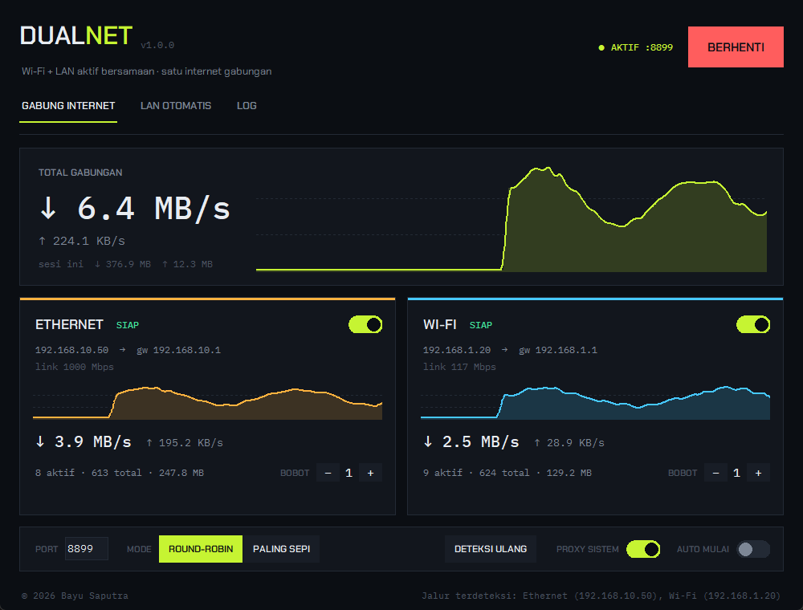

<p align="center"></p>

<h1 align="center">DualNet</h1>
<p align="center"><b>Wi-Fi + LAN aktif bersamaan di Windows: satu internet gabungan.</b><br>
Ditambah <b>LAN Otomatis</b>: IP static di kantor, DHCP di rumah, tinggal colok kabel.</p>

<p align="center"></p>

---

## Fitur

**Gabung Internet (Wi-Fi + LAN)**
- Kedua adapter dipakai sekaligus, tanpa harus memilih salah satu.
- Load balancing per koneksi: *round-robin berbobot* atau *koneksi paling sepi*.
- Bobot per jalur (mis. LAN 2 : Wi-Fi 1) dan on/off per jalur.
- Failover otomatis: kalau satu jalur putus, koneksi baru langsung lewat jalur lain.
- Proxy lokal **SOCKS5 + HTTP/HTTPS** di `127.0.0.1:8899`, bisa dipasang otomatis sebagai proxy sistem Windows (dan dikembalikan seperti semula saat berhenti).
- Grafik kecepatan live per jalur dan total gabungan.

**LAN Otomatis (Kantor / Rumah)**
- Saat kabel LAN dicolok, DualNet mencoba DHCP:
  - dapat IP di luar subnet kantor → **RUMAH** (tetap DHCP)
  - tidak dapat IP / ternyata subnet kantor → **KANTOR** (pasang IP static kantor)
- Profil kantor bisa diambil sekali klik dari setting LAN yang sedang aktif.
- Mendukung banyak IP sekaligus, gateway dan DNS.
- Opsi jalan otomatis saat Windows login (Task Scheduler, tanpa prompt UAC).

**Ringan**
- Status kabel/adapter dibaca langsung dari Windows API (`GetIfEntry2`), tanpa memanggil PowerShell berulang.
- UI hanya digambar ulang saat terlihat; saat diminimize tidak ada redraw.
- Tanpa dependensi luar: Python standar + Tkinter.

## Instalasi

Unduh **`DualNet-Setup-x.y.z.exe`** dari halaman [Releases](../../releases), jalankan, lalu buka DualNet dari Start Menu.
Aplikasi meminta hak Administrator karena mengubah IP adapter (fitur LAN Otomatis).

## Cara pakai

1. Sambungkan **Wi-Fi** dan **kabel LAN**.
2. Buka DualNet → tab **GABUNG INTERNET** → klik **MULAI GABUNG**.
3. Selesai. Browser dan aplikasi yang memakai proxy sistem Windows akan memakai kedua jalur.

Untuk LAN Otomatis:
1. Saat di kantor (IP static masih aktif), buka tab **LAN OTOMATIS** → **AMBIL DARI LAN SEKARANG**.
2. Nyalakan **OTOMATIS** (dan **STARTUP WINDOWS** kalau mau jalan sendiri saat login).
3. Mulai sekarang cukup colok kabel; DualNet memilih Static atau DHCP sendiri.

## Penting untuk diketahui

- **Penggabungan berlaku per koneksi.** Satu unduhan dengan satu koneksi tetap lewat satu jalur. Kecepatan gabungan terasa saat ada banyak koneksi: browsing banyak tab, download manager multi-koneksi (IDM, aria2), update game, torrent, dll.
- Aplikasi yang tidak memakai proxy sistem (sebagian game, UDP) tetap memakai rute default Windows. Aplikasi seperti itu bisa diarahkan manual ke SOCKS5 `127.0.0.1:8899`.
- **VPN full-tunnel (Cloudflare WARP, dll.) harus dimatikan.** VPN memblokir koneksi yang keluar langsung lewat Wi-Fi/LAN; DualNet akan menampilkan peringatan bila mendeteksinya.
- Jaringan kantor yang mewajibkan proxy/firewall bisa tidak memberi internet langsung lewat LAN. DualNet akan otomatis memakai jalur yang berfungsi.

## Build dari source

Butuh Python 3.10+, PyInstaller dan Inno Setup 6.

```bat
pip install pyinstaller
build.bat
```

Hasil: `dist\DualNet\DualNet.exe` dan `release\DualNet-Setup-1.0.0.exe`.
Menjalankan langsung tanpa build: `python dualnet.py` (sebagai Administrator untuk fitur LAN Otomatis).

## Struktur

| File | Isi |
|---|---|
| `dualnet.py` | GUI (Tkinter, tema gelap custom) |
| `core.py` | Deteksi adapter, load balancer, proxy SOCKS5/HTTP, proxy sistem |
| `autolan.py` | Deteksi kantor/rumah, ganti Static/DHCP, autostart |
| `winnet.py` | Status adapter via Windows API (ctypes) |

## Lisensi

MIT © 2026 **Bayu Saputra**. Lihat [LICENSE](LICENSE).
Font: Chakra Petch dan IBM Plex Mono, SIL Open Font License 1.1.
